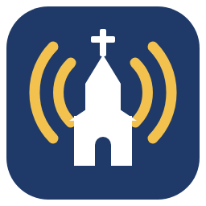

<p align="center">
  
</p>

# ChurchRadio Studio

**Turn your Sunday service recording into a finished radio broadcast — in one drop.**

ChurchRadio Studio is a free Windows app for churches that put their worship service on the
radio (or on a podcast or website). A volunteer drops the week's service recording on the window,
and the app makes one ready-to-air MP3:

**your intro → the service → songs that fill the rest of the hour**

- It **cuts off the organ prelude** before the service begins (but keeps a choir anthem), by
  listening for the words that open your service, such as *"Good morning"*.
- It **ends the service at the congregation's answer** to the dismissal, such as
  *"Go now in peace." — "Thanks be to God."*
- It **shortens long silences** in the service, and plays the songs **back to back with no gaps**.
- It **fills the time** to your broadcast length (for example 60 minutes, never more than 30
  seconds over) with songs from your own collection that **fit the church year**: Advent,
  Christmas, Epiphany, Lent, Holy Week, Easter, Pentecost, plus patriotic songs on national holiday
  weekends. Songs used in recent weeks are played last.
- It evens out the sound with a **broadcast compressor and limiter**, so the radio level stays
  steady between the organ, the sermon and the songs.

Everything runs **on your own PC**. The speech recognition is downloaded once and then works
offline; nothing about your services or songs is sent anywhere.

ChurchRadio Studio was created by **Aaron Steger** for **Bethany Lutheran Church** in
Fredericksburg, Texas, and its weekly radio broadcast, and is shared so other congregations
can use it too. It is published by [Leaven Labs](https://leavenlabs.org) as free software under the
[MIT License](LICENSE). It was developed with the help of [Claude Code](https://claude.com/claude-code).

---

## Contents

- [Install](#install)
- [First start: the setup wizard](#first-start-the-setup-wizard)
- [Making the broadcast each week](#making-the-broadcast-each-week)
- [How the cuts work](#how-the-cuts-work)
- [Your songs](#your-songs)
- [Settings](#settings)
- [Where your files are](#where-your-files-are)
- [Updating](#updating)
- [Troubleshooting](#troubleshooting)
- [For developers](#for-developers)
- [Third-party software](#third-party-software)
- [Reporting a security problem](#reporting-a-security-problem)
- [License and credits](#license-and-credits)

---

## Install

You need a Windows 10 or 11 PC (64-bit). Nothing else: no Python, and ffmpeg is included.

1. Go to the **[Releases](../../releases)** page and download **`ChurchRadio-Studio-Setup.exe`**.
2. Double-click it and follow the steps. Choose **Install for me only** if you are not an
   administrator on the PC.
3. **"Windows protected your PC"?** The installer is not code-signed yet, so Windows does not
   know the publisher. Click **More info** → **Run anyway**.

The installer adds ChurchRadio Studio to the Start menu (and, if you tick it, the desktop) and adds
an uninstaller under Windows **Settings → Apps**.

The first start needs **internet once** to download the two speech-recognition models (about
620 MB together). After that the app works offline.

## First start: the setup wizard

The first time the app opens, a short wizard sets it up for your church. You can change all of it
later with the **Settings...** button.

1. **Welcome** — what the wizard will ask for.
2. **Broadcast** — your station's or program's name (used for the MP3 file name, e.g.
   `St. John Radio 2026-11-15.mp3`), the broadcast length, how far over it may run, and where to
   save the MP3 (empty = next to the service recording).
3. **Intro** — the intro that plays first (with a **Play** button), or no intro.
4. **Songs** — the folders that hold your songs. Folders inside them are included.
5. **Service words** — the words your service starts with, the pastor's last words, and the
   congregation's answer. Type them the way they are said in your church. Also: which national
   holidays get patriotic songs.
6. **Speech models** — download them now (with a progress bar), or let the first broadcast do it.
7. **Done** — a summary. Click **Finish**.

## Making the broadcast each week

1. Start **ChurchRadio Studio**.
2. **Drop the service recording on the window** (MKV, MP4, WAV, MP3 or M4A), or click **Browse...**.
   You can also drop the file on the program's icon.
3. Watch the log. A broadcast takes a few minutes: about 30 seconds to find the start, 1 to 3
   minutes to find the end, then joining and compressing.
4. The MP3 is saved, and the app tells you where.

**The service date** sets the church season. The window shows the coming Sunday (or today, on a
Sunday). Click the date to pick another one from a calendar. If you don't pick one and the file name
holds a date — `10.11.2026`, `10-11-2026` (month first) or `2026-10-11` — that date is used and shown
in the window; a date you picked in the calendar always wins.

**Options in the window:**
- **Service start** — **Auto** (cut the organ prelude, keep a choir anthem), **Organ start** (always
  cut right at the start words), or **Keep start** (cut nothing, for example for a bell-choir
  prelude you want to keep).
- **End the service at "…"** — untick to keep everything after the service.
- **Compress the final MP3** — untick to save it without the broadcast compressor.

**Too long?** If the intro and the service alone are longer than the broadcast, no songs are added;
the MP3 is still saved and a warning says how much too long it is, so you can trim it by hand (for
example in Audacity).

## How the cuts work

ChurchRadio Studio uses speech recognition ([faster-whisper](https://github.com/SYSTRAN/faster-whisper))
to find the words that mark the start and the end of the service. Small recognition mistakes are
allowed. The log shows every match it heard, with the time and how sure it was, so you can check a
cut.

**Start of the service.** The app listens to the first 30 minutes for your start words (default
*"Good morning"*) and cuts just before them.
- People chatting near the microphone during the prelude are sometimes heard as "Good morning".
  The app is much less sure of those than of the pastor at the microphone, so an unsure one is
  skipped when a surer one follows within 5 minutes.
- In **Auto** mode, if a choir sings after a short pause before the start words, the song is kept and
  only the organ before the pause is cut.
- If the start words are not heard, nothing is cut at the start.

**End of the service.** The app listens to the last 10 minutes with a more exact model for the
pastor's last words (default *"Go now in peace"*) and the congregation's answer (default *"Thanks be
to God"*). The cut is just after the answer, if it comes within 20 seconds. If the answer is not
heard, the cut is a few seconds after the pastor's words. A "Thanks be to God" earlier in the service
(after a reading) is never used. The words heard are saved to `end_words.txt` for checking.

**Silences.** Silences in the service longer than 5 seconds are shortened. Silence at the start and
end of each song, and at the very end of the service, is removed, so each part follows the one
before without a gap.

## Your songs

Click **Songs...** in the main window to see every song with its title, seasons, length and how many
words were heard in it.

- **Turn a song on or off** — click the tick in the **On** column (or select several and click
  **Turn on** / **Turn off**). Songs that are off are never used.
- **Rename** — double-click the title.
- **Seasons** — double-click the seasons and tick when the song may play. None ticked = **General**
  (any time of the year). Holy Week also uses Lent songs. **Patriotic** songs play only on the
  weekend nearest a national holiday you chose, and then they come first.
- **Play** — opens the song in your music player.
- **Find** / **Show** — search by name, or show only songs that are on, off, or have no words.
- **Look for new songs** — scan your song folders again.

Every change is saved at once.

### Add songs

**Songs... → Add songs...** and pick the song files (from a USB stick, a download folder, anywhere).
For each one the app suggests a **title** and **seasons**:

1. from the **tags** in the file, if they hold a real title (not "Track 03");
2. else from the **lyrics** — the app listens to the start of the song and matches the words against
   a list of about 140 well-known hymns and songs (first lines and refrains), even when a few words
   are misheard;
3. else from the **file name**.

A table shows each suggestion, how it was found, and the words that were heard. Unsure ones are shown
in orange. Correct anything, untick songs you don't want, choose the folder to put them in, and click
**Add**: the files are copied there, measured, and added to your list.

### Import a song list

**Songs... → Import list...** adds many songs at once, or changes the titles, seasons and on/off of
songs already in your list, from a CSV file. Click **Download template...** to save a starting file,
fill it in Excel (keep it as CSV), then click **Import a file...**. Columns:

- `file` — the song's full path, or just its file name if it is in one of your song folders;
- `title` — the song name;
- `seasons` — the [season words](#teach-it-your-own-songs) separated by `;` (`Holy Week` and
  `General` also work); empty or `general` = any time of the year;
- `enabled` — `yes` or `no`.

For a song already in your list, an empty cell keeps what is there now. A new song with no seasons
gets them guessed from its file and folder name. The song files are not copied: they stay where they
are. Lines that can't be used (a file that isn't found, an unknown season) are skipped, and the app
lists them.

**Identify...** does the same for songs already in your list — select some, or select none to do every
song that has no title yet.

### Songs with no words

Instrumental pieces usually don't suit the radio filler. The first time a song is used, the app
listens to it once and counts the words; a song with fewer than 6 is turned off and the log says
so. This happens only once per song: if you turn one back on, it stays on.

### Teach it your own songs

The hymn list is `hymns.csv` in the program. To add your own songs — a choir piece, a local
favourite — create a `hymns.csv` in [your settings folder](#where-your-files-are) with these columns:

```csv
title,first_line,also,seasons
Our Parish Song,We gather on the prairie wide,Alleluia to the Lord of harvest,
Lo How a Rose E'er Blooming,Lo how a rose e'er blooming,,advent;christmas
```

`also` is another line, such as the refrain. `seasons` uses the words below, separated by `;`, or is
empty for General. A song with the same title as one in the program's list replaces it. A song can also
be listed by title only (leave `first_line` and `also` empty): it is then recognised when its title is
sung, for example in the refrain.

The program's list includes lyric lines only for hymns in the public domain. Newer songs that are
still under copyright are listed by title only.

**Season words:** `advent`, `christmas`, `epiphany`, `lent`, `holyweek`, `easter`, `pentecost`,
`patriotic`.

## Settings

Most settings are in **Settings...**. All of them are in `config.json` in your
[settings folder](#where-your-files-are); open it in Notepad to change the rest (close the app first).

| Setting | Default | What it does |
|---|---|---|
| `broadcast_name` | `Church Radio` | Name used in the MP3 file name and title. |
| `intro` | (none) | The intro file. Empty = no intro. |
| `song_folders` | (none) | Folders with your songs (folders inside them are included). |
| `output_folder` | (none) | Where to save the MP3. Empty = next to the service recording. |
| `target_minutes` | `60` | Broadcast length. |
| `tolerance_seconds` | `30` | The songs never make it more than this much longer. |
| `service_start` | `Auto` | `Auto`, `Organ start` or `Keep start` (see above). |
| `start_phrase` | `Good morning` | Words that start the service. |
| `start_min_sure` | `0.75` | An earlier "Good morning" less sure than this (75 %) is skipped. `0` = always use the first. |
| `start_skip_minutes` | `5` | …but only if a surer one follows within this time. |
| `end_phrase` | `Go now in peace` | The pastor's last words. Empty = nothing cut at the end. |
| `end_answer_phrase` | `Thanks be to God` | The congregation's answer; the cut is right after it. Empty = no answer. |
| `end_answer_window` | `20` | The answer must start within this many seconds. |
| `end_answer_pad` | `0.5` | Seconds kept after the answer. |
| `end_alt_phrase` | `and we will` | If the answer is not heard: cut right after these words, if heard soon after. |
| `end_alt_window` / `end_alt_pad` | `20` / `0.5` | Same as above, for `end_alt_phrase`. |
| `end_after_seconds` | `5` | If neither is heard: cut this long after the pastor's last words. |
| `end_search_minutes` | `10` | How much of the end of the recording is searched. |
| `max_silence_seconds` / `silence_level_db` | `5` / `-40` | Silences in the service longer than this, quieter than this, are shortened. |
| `trim_song_silence` / `song_silence_db` | `true` / `-50` | Remove the silence at the start and end of songs, quieter than this. |
| `check_song_words` / `song_min_words` | `true` / `6` | Turn off songs with fewer words than this (once per song). |
| `avoid_repeat_weeks` | `4` | Songs used in this many recent broadcasts are played last. |
| `patriotic_holidays` | `memorial`, `independence`, `veterans` | Weekends that get patriotic songs. `labor` is also possible. |
| `mp3_bitrate` | `192k` | MP3 quality. |
| `compression` | 4:1 above -18 dB, +6 dB, limit -1 dB | `enabled`, `ratio`, `threshold_db`, `attack_ms` (20), `release_ms` (250), `makeup_db`, `limit_db`. |
| `models_folder` | (none) | A folder that already holds the speech models (copied in once). |
| `setup_done` | `false` | Set it to `false` to see the setup wizard again. |

**Song list (`songs.csv`).** The Songs window edits it, but you can also open it in Excel. Columns:
`file`, `title`, `duration`, `seasons`, `enabled` (`yes`/`no`), `words` (words heard; empty = not
checked yet), `start_silence` / `end_silence` (seconds; empty = not measured yet). If a song folder
can't be found (moved, or a drive not plugged in), its songs stay in the list with your edits.

## Where your files are

| What | Where |
|---|---|
| The program (and ffmpeg) | `C:\Program Files\ChurchRadio Studio` (or your own programs folder) |
| Your settings, song list, history, `end_words.txt`, your `hymns.csv` | `%APPDATA%\ChurchRadio Studio` |
| The speech models (one copy per PC) | `C:\ProgramData\ChurchRadio Studio\models` |

To open your settings folder, paste `%APPDATA%\ChurchRadio Studio` into the File Explorer address bar.
Uninstalling removes only the program; your settings and the models stay, so a reinstall carries on
where you left off.

## Updating

Download the newest `ChurchRadio-Studio-Setup.exe` from the **[Releases](../../releases)** page and run
it. It updates the existing installation and keeps your settings, songs and history. The speech models
already on the PC are used where they are — nothing is downloaded again.

## Troubleshooting

**The cut at the start or end is wrong.** Look at the log: it lists every start and end phrase it
heard, with the time and how sure it was. Check that your **Service words** (Settings) match what is
actually said, and the **Service start** mode. The end words heard are in `end_words.txt` in your
settings folder — send that file along if you ask for help.

**The MP3 is too long.** The intro and service alone are longer than the broadcast, so no songs were
added. Trim it by hand, or raise the broadcast length.

**A song keeps being chosen that shouldn't be.** Open **Songs...** and turn it off, or change its
seasons.

**The speech models won't download.** The first start needs internet once (about 620 MB). If a PC
has no internet, copy the `models` folder from another PC into `C:\ProgramData\ChurchRadio Studio\`,
or set `models_folder` to a folder that holds them.

**Check the installation without opening the window:**

```
"C:\Program Files\ChurchRadio Studio\ChurchRadio-Studio.exe" --selftest
```

It prints where the program, your files, ffmpeg and the models are, loads both models, and ends with
`selftest: OK`.

## For developers

ChurchRadio Studio is written in Python 3.11+ with tkinter.

**Run from the source code**

```
pip install -r requirements.txt
python app.py
```

ffmpeg must be available: in an `ffmpeg` folder next to the code, on `PATH`, or in
`C:\ffmpeg\bin`. Set the environment variable `CHURCHRADIO_DATA_DIR` to keep the settings in a test
folder instead of your real one.

**Run the tests**

```
python -m unittest discover -s tests
```

**Build and release.** `.github/workflows/release.yml` runs on Windows for every pull request and
release: it runs the tests, builds the program folder with PyInstaller (`ChurchRadio-Studio.spec`),
downloads and checks an LGPL build of ffmpeg, makes the installer with Inno Setup (`installer.iss`),
then installs it, self-tests the installed app, tests an update from the previous release, and
uninstalls it. The installer is attached to the run for testing. To publish a release, run the
**Release** workflow from the Actions tab with a version such as `v1.0.0` (or push a tag `v…`).

**Where things are**

| File | What it is |
|---|---|
| `app.py` | The main window. |
| `datepicker.py` | The service date box and its pop-out calendar. |
| `setup_wizard.py` | The setup wizard, also used by **Settings...**. |
| `songs_window.py` | The Songs window. |
| `add_songs.py` | Add songs / Identify: the review table and saving. |
| `builder.py` | Makes one broadcast: intro + service + songs. |
| `prelude.py` | Speech recognition: finding the start and end of the service. |
| `audio.py` | ffmpeg: lengths, silence, trimming, joining, compression. |
| `picker.py` | Picks the songs that fill the time. |
| `catalog.py` | The song list (`songs.csv`), seasons, songs with no words, importing a song list. |
| `identify.py` | Finds a song's title and seasons from tags, lyrics or file name. |
| `hymns.csv` | The hymn list used to recognise songs. |
| `churchyear.py` | The church year, patriotic holiday weekends, the default service date. |
| `paths.py` | Where the program, its defaults and the user's files are. |
| `config.json` | Default settings (copied to the user's folder on first start). |
| `assets/` | The icon (`icon.svg` is the source; `icon.ico` and `icon-256.png` are made from it). |
| `ChurchRadio-Studio.spec` | PyInstaller recipe. |
| `installer.iss` | Inno Setup recipe for the installer. |
| `ChurchRadio Studio.bat` | Starts the app from the source code on Windows. |
| `tools/third_party_licenses.py` | Collects the third-party licenses for the installer. |
| `LICENSE` | The MIT License. |
| `tests/test_core.py` | The tests. |

## Third-party software

ChurchRadio Studio uses, and the installer includes, the software below. The full license texts are
installed in the program's `licenses` folder (**About → Licenses** in the app); the list is made by
`tools/third_party_licenses.py` during each build from what the program actually includes.

- **[FFmpeg](https://ffmpeg.org)** — audio reading, trimming and encoding. The installer ships an LGPL
  build (from [BtbN/FFmpeg-Builds](https://github.com/BtbN/FFmpeg-Builds)) in the `ffmpeg` folder, with
  its license. ChurchRadio Studio runs it as a separate program and does not change it.
- **[faster-whisper](https://github.com/SYSTRAN/faster-whisper)** (MIT) with
  **[CTranslate2](https://github.com/OpenNMT/CTranslate2)** (MIT), and the **Whisper** speech models
  `base.en` and `small.en` (MIT), downloaded on first use.
- **[tkinterdnd2](https://github.com/Eliav2/tkinterdnd2)** (MIT) — drag and drop.
- **[NumPy](https://numpy.org)** (BSD), **[PyAV](https://github.com/PyAV-Org/PyAV)** (BSD), Hugging Face
  **huggingface_hub** and **tokenizers** (Apache 2.0), **ONNX Runtime** (MIT), and their dependencies.
- **Python** (PSF License) and **Tcl/Tk** (BSD-style), built into the program.

## Reporting a security problem

Please don't open a public issue. See [SECURITY.md](SECURITY.md) for how to report it privately.

## License and credits

ChurchRadio Studio is free software under the **[MIT License](LICENSE)**: anyone may use, copy, change
and share it, including for other churches, as long as the copyright notice and license are kept with
it.

Copyright (c) 2026 **Aaron Steger**. Published by **[Leaven Labs](https://leavenlabs.org)**.

Created by Aaron Steger for Bethany Lutheran Church, Fredericksburg, Texas, and its radio
broadcast. Developed with the help of Claude Code. The app's **About** box shows the author, the
publisher, the version and the license.
